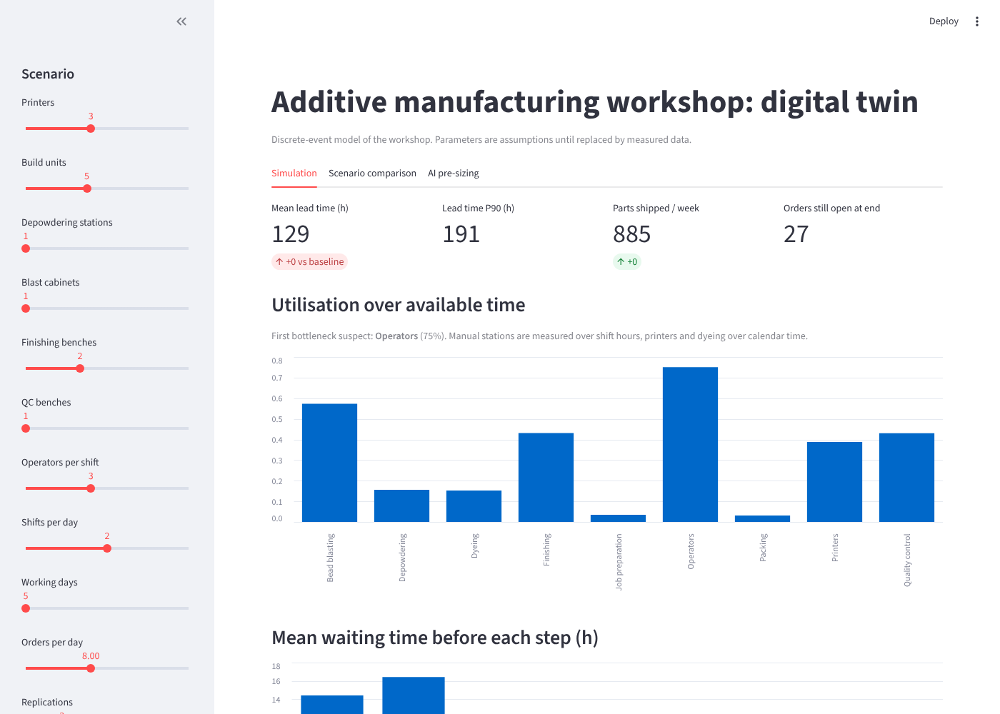
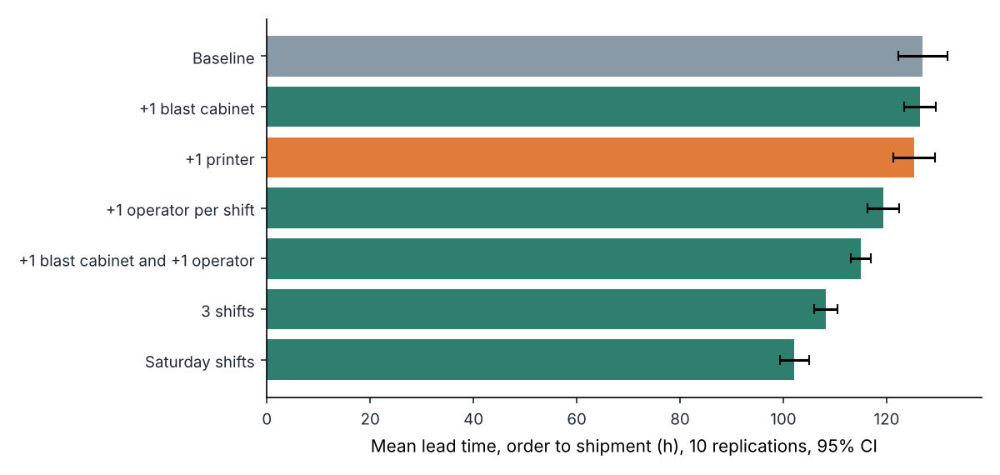
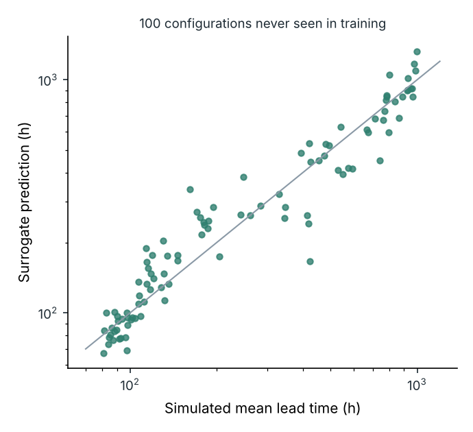

# Jumeau numérique d'un atelier de fabrication additive

[](https://github.com/Abderrahmane-BOULAMI/am-workshop-twin/actions/workflows/tests.yml)

Un atelier de fabrication additive par fusion de poudre ne se pilote pas comme une imprimante : entre la commande et
l'expédition, une pièce passe par la préparation du plateau, l'impression, le refroidissement, le dépoudrage, le
sablage, la teinture, la finition, le contrôle et le conditionnement. Une partie tourne jour et nuit (impression,
refroidissement), le reste dépend des équipes. Quand les délais s'allongent, la tentation est d'acheter une imprimante.
Ce projet construit un **jumeau numérique de production** pour vérifier ce genre de décision avant de la prendre :

1. **Un modèle à événements discrets** de l'atelier (SimPy) : 10 étapes, plateaux partagés, postes, opérateurs
   disponibles seulement sur les horaires d'équipe, rebuts renvoyés en réimpression.
2. **L'évaluation de scénarios** avec 10 réplications et intervalles de confiance, et une **recherche du goulot** par
   ajout d'une unité de chaque ressource.
3. **Un modèle d'IA de substitution** (gradient boosting) appris sur 400 simulations, qui trie 17 280 configurations
   en moins d'une seconde ; la simulation confirme ensuite les meilleures.
4. **Un tableau de bord d'aide à la décision** (Streamlit).
5. **Les briques de connexion aux machines** : lecture de G-code (durée, couches, hauteur, filament) et lecture de
   l'état des imprimantes par API HTTP, avec recalage de la loi de temps d'impression sur les impressions réelles.

Tous les paramètres (temps, effectifs, demande, coûts) sont des **hypothèses** écrites dans
[`config/baseline.yaml`](config/baseline.yaml), à remplacer par les mesures de l'atelier. Les conclusions ci-dessous
valent pour ces hypothèses et montrent ce que l'outil permet de trancher.



## Résultats

### 1. Le goulot est la main-d'œuvre de post-traitement, pas les imprimantes

Situation de référence : 3 imprimantes, 2 équipes de 3 opérateurs du lundi au vendredi, 8 commandes par jour.
Délai moyen commande-expédition **127 h ± 5**, 882 pièces par semaine, plateaux remplis à 95 %.

| Ressource | Taux d'utilisation sur le temps disponible |
|---|---|
| Opérateurs | **75 %** |
| Sablage | 57 % |
| Contrôle qualité | 43 % |
| Finition | 43 % |
| Imprimantes | 39 % |



| Scénario (10 réplications) | Délai moyen (h) | Délai P90 (h) |
|---|---|---|
| Référence | 127,0 ± 4,8 | 181 |
| +1 imprimante | 125,3 ± 4,0 | 176 |
| +1 cabine de sablage | 126,4 ± 3,1 | 183 |
| +1 opérateur par équipe | 119,4 ± 3,1 | 170 |
| +1 cabine et +1 opérateur | 115,0 ± 2,0 | 168 |
| 3 équipes | 108,2 ± 2,3 | 160 |
| Équipes le samedi | **102,2 ± 2,9** | 150 |

Ajouter une imprimante ne change pas le délai de façon mesurable ; ajouter une unité de chaque ressource, une à la
fois, confirme que seul l'opérateur supplémentaire apporte un gain significatif (7,5 h ± 3,1). Ouvrir les postes
manuels plus longtemps (samedi, troisième équipe) réduit le délai de 15 à 20 %.

### 2. Une hausse de 30 % de la demande double le délai, sauf si l'on renforce le post-traitement

| Demande +30 % | Délai moyen (h) | Commandes encore ouvertes en fin de période |
|---|---|---|
| Sans changement | 255 ± 53 | 97 |
| +1 cabine de sablage et +1 opérateur par équipe | 128 ± 6 | 44 |

### 3. L'IA propose, la simulation tranche

Le modèle de substitution, appris sur 400 configurations tirées au hasard, prédit le délai de 100 configurations
jamais vues avec un R² de 0,92 (erreur relative moyenne 18 %) et le débit avec un R² de 0,91.



Question posée : avec 30 % de demande en plus, quelle est la configuration la moins chère qui tient un délai moyen de
110 h ? Le modèle trie 17 280 configurations, la simulation en vérifie 3 :

| Configuration proposée | Prédit (h) | Simulé (h) | Tient 110 h |
|---|---|---|---|
| 2 imprimantes, 6 plateaux, 2 opérateurs, 3 équipes, 6 jours | 108,6 | 111,1 ± 2,7 | non |
| 2 imprimantes, 2 postes de dépoudrage, 2 opérateurs, 3 équipes, 6 jours | 100,9 | 112,8 ± 4,5 | non |
| **2 imprimantes, 2 cabines, 3 établis de finition, 2 postes de contrôle, 2 opérateurs, 3 équipes, 6 jours** | 109,2 | **107,4 ± 4,8** | **oui** |

La configuration retenue coûte 653 k€ par an dans le modèle de coûts indicatif, contre 665 k€ pour la configuration
actuelle qui, à cette demande, monte à 255 h. Deux des trois propositions échouent à la vérification : le modèle de
substitution sert à réduire la recherche, pas à décider. Un premier essai avec un objectif de 72 h l'a confirmé :
le modèle prédisait 61 à 67 h pour des configurations qui en donnent 92 à 103 en simulation, parce que l'objectif
était sous le plus court délai présent dans ses données d'apprentissage (80 h).

### 4. Connexion aux machines

- `amtwin/gcode.py` estime la durée d'une impression FDM à partir du G-code (profil de vitesse trapézoïdal), compte
  les couches, la hauteur et le filament, et lit l'estimation du trancheur si elle est présente.
- `amtwin/connectors.py` interroge les imprimantes par HTTP (API compatible OctoPrint : état, avancement, temps
  restant) et recale la loi « durée = base + pente × hauteur » sur les impressions terminées. Testé contre un faux
  serveur, pas contre une machine réelle.

## Limites

- Paramètres supposés, aucune donnée d'atelier réel ; le modèle doit être calé sur les temps mesurés avant usage.
- Pas de pannes machines ni de maintenance planifiée des imprimantes ; une commande est expédiée en une fois.
- Les coûts sont indicatifs et ne servent qu'à classer les configurations.

## Lancer le projet

```bash
pip install -r requirements.txt
pytest -q                               # 13 tests
python experiments/build_dataset.py     # 400 simulations pour le modèle de substitution (environ 4 min)
python experiments/run_all.py           # scénarios, goulot, recommandation (environ 2 min)
python experiments/plot_results.py
streamlit run app/dashboard.py
```

## Organisation

```
config/baseline.yaml     hypothèses de l'atelier (temps, ressources, équipes, demande, coûts)
amtwin/model.py          modèle à événements discrets et indicateurs
amtwin/scenarios.py      réplications, intervalles de confiance, recherche du goulot
amtwin/surrogate.py      plan d'expériences, modèle de substitution, recommandation
amtwin/gcode.py          lecture et estimation de durée du G-code
amtwin/connectors.py     lecture HTTP de l'état des imprimantes, recalage du temps d'impression
app/dashboard.py         tableau de bord d'aide à la décision
results/                 chiffres et figures de ce README
```

Licence MIT.
